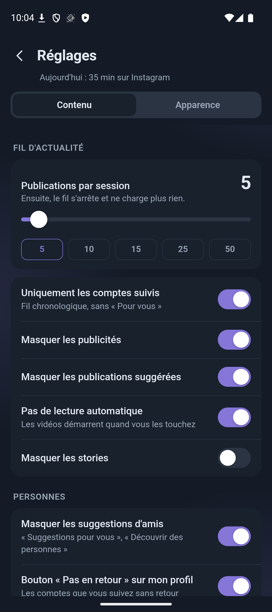
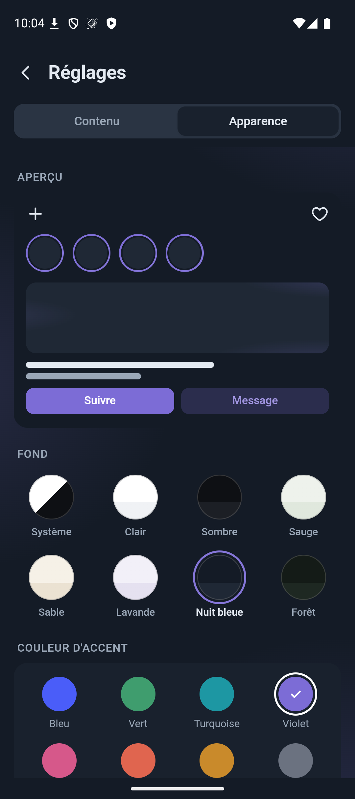

# CalmFeed

**Une app Android pour garder Instagram pour ce qu'il a de mieux : parler à ses proches.**
CalmFeed affiche le site mobile d'Instagram dans une WebView et retire ce qui sert à faire défiler sans fin : Reels, publicités, suggestions, fil infini.

> ⚠️ Projet personnel non officiel, **sans lien avec Instagram ni Meta**. Il modifie uniquement l'affichage, sur votre téléphone. Modifier l'affichage d'un site reste contraire aux conditions d'utilisation d'Instagram, comme un bloqueur de pub. Utilisation à vos risques.

<p>
  
  
</p>

## Ce que fait l'app

**Fil d'actualité**
- Nombre de publications par session au choix (5, 10, 15…). Ensuite, « Vous avez vu vos N publications » et le fil s'arrête : la page ne charge plus rien.
- Uniquement les comptes suivis (chronologique), sans pubs ni publications suggérées. Les pubs ne comptent pas dans la limite.
- Variété : au plus 1 publication par compte et par session (réglable), pour que les comptes très actifs ne remplissent plus tout le fil.
- Chaque actualisation ne montre que des publications inédites : celles déjà vues à l'écran sont sautées (mémoire de 7 jours sur le téléphone, désactivable).
- Pas de lecture automatique des vidéos.

**Reels et Explorer**
- Reels bloqués par défaut : l'onglet, le flux et les reels dans le fil. Un reel reçu en message peut s'ouvrir seul (option).
- La loupe affiche la grille par lots (10 par défaut), avec un bouton « Voir 10 de plus ».

**Personnes**
- Suggestions d'amis masquées partout.
- Bouton **« Pas en retour »** sur votre profil : la liste des comptes que vous suivez et qui ne vous suivent pas, avec « Se désabonner ».

**Application**
- Une WebView par onglet (Accueil, Recherche, Reels, Messages, Profil) sous une barre d'onglets native. Changer d'onglet est instantané : la page reste chargée, à la même position.
- Retour ou glissement depuis le bord : page précédente de l'onglet (ex. conversation → liste des messages), puis Accueil, puis « Glissez à nouveau pour quitter ».
- Écran de chargement aux couleurs du thème le temps qu'un onglet se construise : pas de flash ni de mise en page qui saute.
- Tirer vers le bas en haut du fil pour charger les dernières publications (au plus toutes les 20 s).

**Notifications de messages privés**
- Nom et photo de l'expéditeur, début du message, bouton « Répondre » quand il n'y a qu'une notification. La réponse passe par l'interface d'Instagram, en arrière-plan.
- Seuls les nouveaux messages privés notifient (pas les notes, pas les conversations déjà non lues).
- Mode Instantané (par défaut) : la connexion temps réel d'Instagram reste ouverte en arrière-plan, sans requête répétée ; une notification discrète « Messages connectés » le signale. Coupée la nuit (23 h – 8 h).
- Modes 15 / 30 min : coup d'œil périodique, sans notification permanente.
- Onglet de réglages dédié : aperçu, photo, réponse rapide, fréquence, heures calmes, notification d'essai.

**Gestes**
- Double-tap sur une publication ou un reel : j'aime. Double-tap sur un message privé : ❤️.
- Appui long sur un message privé : sélecteur de réactions d'Instagram.
- Toutes ces actions passent par les boutons d'Instagram, avec au moins 1,2 s entre deux et 25 au plus en 10 minutes.

**Reels** (si vous les autorisez)
- Plein écran, avec ＋ (création) à gauche et un interrupteur « Pour toi / Abonnements » à droite. « Abonnements » utilise le fil « Following » d'Instagram.
- Nombre de reels par session au choix, puis écran de fin.

**Interface**
- Barres façon application : ＋, ♥ (avec sa pastille de notification) et ⚙ en haut ; onglet actif en évidence en bas.
- Bulle « Votre story » en tête des stories. Glisser une story vers le bas la referme dans son cercle.
- Les flèches de retour d'Instagram reviennent à la page précédente.
- Apparence : un fond (Système, Clair, Sombre, Sauge, Sable, Lavande, Nuit bleue, Forêt) et une couleur d'accent (8 choix). Les contrastes sont ajustés automatiquement pour rester lisibles.
- Taille du texte réglable, compteur de temps passé dans la journée.

## Discrétion vis-à-vis d'Instagram

L'app est conçue pour ne pas ressembler à un robot :
- Elle **n'envoie aucune requête de plus** que le site officiel. Elle masque du contenu et met en attente les requêtes « charger la suite » quand une limite est atteinte.
- Pas d'API privée, pas de défilement automatique, pas de like ni de follow automatique.
- User-Agent standard de Chrome Android.
- « Pas en retour » ne se lance qu'à la demande. Il utilise les mêmes requêtes que la liste « Suivi(e)s » du site, une page de 12 comptes toutes les 2 à 3 secondes, et garde le résultat 24 h en cache. Les désabonnements sont espacés de 4 s minimum, 30 par heure au plus.

## Installer

1. Téléchargez `CalmFeed-x.y.z.apk` depuis la page [Releases](../../releases).
2. Sur le téléphone, autorisez l'installation depuis cette source, puis ouvrez l'APK.
3. Connectez-vous à Instagram dans l'app. La connexion reste sur votre téléphone : l'app ne la transmet nulle part.

Android 8.0 ou plus récent.

## Compiler soi-même

Il faut le JDK fourni avec Android Studio et le SDK Android (compileSdk 36).

```bash
./gradlew assembleDebug
```

APK : `app/build/outputs/apk/debug/app-debug.apk`.

Pour une build **release** signée, créez un fichier `keystore.properties` à la racine. Il est ignoré par Git : ne le publiez jamais.

```
storeFile=/chemin/vers/votre.jks
storePassword=...
keyAlias=...
keyPassword=...
```

puis :

```bash
./gradlew assembleRelease
```

## Structure

```
app/src/main/
  assets/js/core.js         noyau : ordonnanceur, navigation interne, file d'attente réseau
  assets/js/theme.js        couleurs (variables CSS d'Instagram) + contrôle de contraste
  assets/js/feed.js         fil : reels, pubs, suggestions, limite, « Suivi(e) », autoplay
  assets/js/social.js       suggestions d'amis, bandeau « Utiliser l'application »
  assets/js/explore.js      loupe par lots
  assets/js/reels.js        page Reels : plein écran, interrupteur, limite
  assets/js/gestures.js     double-tap, appui long, réactions
  assets/js/stories.js      fermeture d'une story par glissement
  assets/js/notify.js       lecture des messages non lus, ouvrir / répondre
  assets/js/chrome.js       barres du haut / du bas, bulle « Votre story »
  assets/js/nonfollowers.js « Pas en retour »
  assets/js/boot.js         démarrage
  assets/settings.html      écran de réglages (local, sans réseau)
  assets/themes.json        fonds et couleurs d'accent
  java/app/calmfeed/        MainActivity (onglets natifs), SettingsActivity, Prefs, Themes,
                            Notifier, ReplyReceiver, InboxWorker, DmService, ScriptLib
```

Pour le débogage, la build debug permet d'inspecter la page via `chrome://inspect` ; tapez `window.__cfDebug` dans la console.

Si Instagram change son site, il suffit en général d'adapter un fichier JS. Les sélecteurs reposent sur les liens, les libellés d'accessibilité et les rôles, jamais sur les classes CSS générées. [ANALYSE_INSTAGRAM_WEB.md](ANALYSE_INSTAGRAM_WEB.md) détaille la structure du site.
